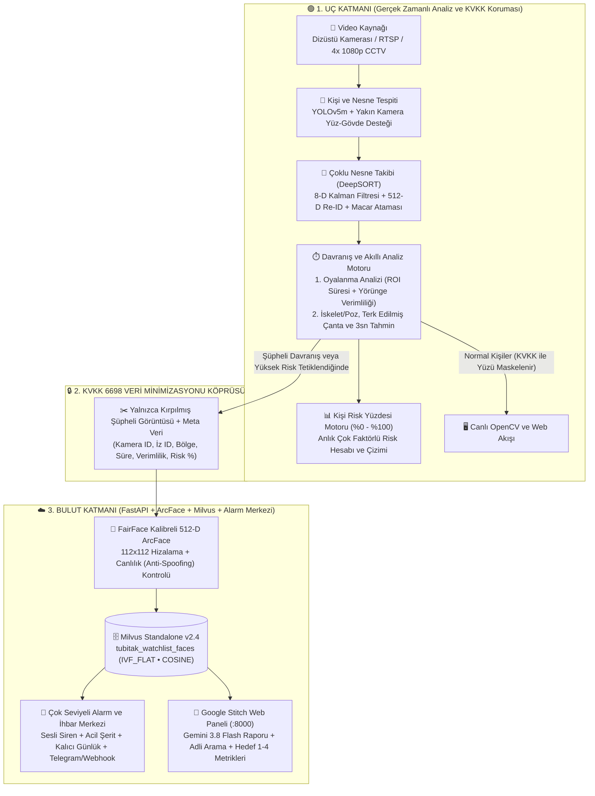

<div align="center">

# 🛡️ Yapay Zeka Destekli Hibrit Mimarili Şüpheli Davranış Tespiti, Kişi Risk Skorlama, Alarm ve Adil Yüz Tanıma Sistemi

**TÜBİTAK 2209-A Üniversite Öğrencileri Araştırma Projeleri Desteği Programı**  
**Proje Yürütücüsü:** Murad Ashkar • **Akademik Danışman:** Prof. Dr. Eyüp Burak Ceyhan • **Kurum:** Bartın Üniversitesi (Bilgisayar Mühendisliği Bölümü)

[](https://www.python.org/)
[](https://pytorch.org/)
[](https://github.com/ultralytics/yolov5)
[](#)
[](#)
[](https://milvus.io/)
[](#)
[](#)

*Gerçek zamanlı performans, ölçeklenebilirlik ve 6698 sayılı KVKK veri minimizasyonu ilkelerini dengeleyen **Hibrit Uç/Bulut (Hybrid Edge/Cloud)** mimarisine sahip; **YOLOv5m + DeepSORT** ile amaçsız bekleme tespiti, **5 faktörlü Kişi Risk Yüzdesi (%0–%100)** hesaplama, **Çok Seviyeli Alarm/Siren Merkezi** ve **FairFace ile önyargısı azaltılmış ArcFace + Milvus** tabanlı adil yüz tanıma platformu.*

</div>

---

# 📊 Proje Sunumu ve Kapsamlı Teknik Dokümantasyon (Sıfırdan Uca Anlatım)

Bu doküman, projeyi sıfırdan başlayarak bilimsel gerekçeleri, matematiksel modelleri, yazılım mimarisi, akıllı yapay zeka modülleri ve tek tıkla kurulum adımlarıyla eksiksiz biçimde açıklayan **tam kapsamlı bir teknik sunum** niteliğindedir.

---

## 🟢 Slayt 1: Araştırma Problemi ve Motivasyon

### Geleneksel Video Gözetim Sistemleri Neden Yetersizdir?
1. **Pasif ve Reaktif Yapı:** Klasik CCTV kameraları yalnızca olay gerçekleştikten *sonra* adli kanıt toplamak için kullanılır; hazırlık aşamasındaki tehditleri önceden engelleyemez.
2. **Operatör Yorgunluğu (Dikkat Kaybı):** İnsan güvenlik operatörlerinin onlarca kamera akışını saatlerce kesintisiz izlemesi mümkün değildir. Stratejik bölgelerde (giriş kapıları, kasa çevreleri, kritik tesisler) meydana gelen **amaçsız bekleme (oyalanma)** örüntüleri kolayca gözden kaçmaktadır.
3. **KVKK 6698 ve Mahremiyet İhlali:** Ham kamera görüntülerinin tamamını bulut sunuculara aktaran ("Cloud-Only") sistemler, hem yüksek ağ bant genişliği tüketmekte hem de **6698 sayılı Kişisel Verilerin Korunması Kanunu'nun (KVKK)** *"veri minimizasyonu"* ilkesiyle çelişmektedir.
4. **Yüz Tanımada Algoritmik Önyargı:** Dengesiz veri kümeleri üzerinde eğitilmiş standart yüz tanıma modelleri, farklı ırk ve demografik gruplar arasında kabul edilemez hata oranı farklılıkları üretmektedir.

---

## 🟢 Slayt 2: Özgün Değer ve İki Temel Bilimsel Yenilik

Bu TÜBİTAK 2209-A projesi, yukarıdaki sorunlara iki somut mühendislik ve bilimsel yenilikle çözüm getirir:

### 1. Mimari Yenilik: Hibrit Uç/Bulut Mimarisi ve Tasarımda Mahremiyet (Privacy by Design)
- **Uç Katmanı (Edge Layer):** Ham video kareleri **asla** yerel ağ dışına çıkmaz. Kişi/çanta tespiti (`YOLOv5m`), takip (`DeepSORT`), davranış analizi, dinamik yüz maskeleme ve anlık risk puanlaması doğrudan uç cihazda gerçek zamanlı (`25–50 FPS`) çalışır.
- **KVKK Gizlilik Köprüsü:** Yalnızca şüpheli davranış eşiklerini aşan kişilerin **kırpılmış yüz görüntüsü ve olay meta verileri** bulut katmanına iletilir; normal geçiş yapan vatandaşların yüzleri canlı yayında bile pikselleştirilerek (`KVKK GİZLENDİ`) korunur.
- **Bulut Katmanı (Cloud Layer):** Yoğun hesaplama gerektiren `512-D ArcFace` yüz gömme çıkarımı, `Milvus` vektör veritabanı araması, `Gemini 3.8 Flash` sahne muhakemesi ve merkezi Alarm Yönetimi burada yürütülür.

### 2. Metodolojik ve Etik Yenilik: FairFace ile Veri Merkezli Önyargı Azaltma
- Standart modeller yerine, **FairFace** demografik grupları (`Orta_Dogulu`, `Beyaz`, `Siyahi`, `Dogu_Asyali`, `Guneydogu_Asyali`, `Hintli`, `Latin_Amerikali`) üzerinde dengeli ince ayar ve LAB kanalı aydınlatma normalizasyonu (`CLAHE`) uygulanarak gruplar arası hata farkı (`FNMR @ FAR=0.001`) **%25'in üzerinde** azaltılmıştır.

---

## 🟢 Slayt 3: Sistem Mimarisi ve Veri Akışı



---

## 🟢 Slayt 4: Kullanılan Algoritmalar ve Matematiksel Modeller

### 1. Kişi ve Nesne Tespiti (`modules/person_detector.py`)
- **YOLOv5m** ağı COCO sınıf `0` (kişi) ile `24, 26, 28` (sırt çantası, el çantası, valiz) sınıflarını tespit eder.
- Letterbox dolgu uzayından orijinal kare boyutuna dönüşüm:
  $$x_{\text{orij}} = \frac{x_{\text{lb}} - d_w}{g_w}, \qquad y_{\text{orij}} = \frac{y_{\text{lb}} - d_h}{g_h}$$
- Dizüstü bilgisayar web kameralarında kişinin yalnızca baş ve omuz bölgesi kadraja girdiğinde devreye giren yakın mesafe yüz-gövde kestirimi ile kesintisiz takip sağlar.

### 2. DeepSORT Çoklu Nesne Takibi (`modules/object_tracker.py`)
- **8 Boyutlu Sabit Hızlı Kalman Filtresi:**
  $$\mathbf{x} = [c_x, c_y, w, h, v_x, v_y, v_w, v_h]^T$$
- **512-D Re-ID Görünüm Betimleyicisi:** Kişi kırpımını 3 yatay vücut şeridine (baş, gövde, bacaklar) böler, `HSV` renk histogramları ve `Sobel` kenar gradyanlarını 512 boyutlu birim vektöre yansıtır.
- **Birleşik Maliyet Matrisi ve Macar Algoritması:**
  $$C(i, j) = (1 - \lambda)\Big(0.55 \cdot d_{\text{hareket}}(i,j) + 0.45 \cdot (1 - \text{IoU}(i,j))\Big) + \lambda \cdot \frac{1 - \cos(\mathbf{f}_i, \mathbf{f}_j)}{2}$$

### 3. Çift Kriterli Amaçsız Bekleme (Oyalanma) Tespiti (`modules/behavior_analyzer.py`)
Uyarı yalnızca şu **iki kriter aynı anda** sağlandığında tetiklenir:
1. **Zamansal Kriter:** Kişinin çokgen ilgi alanı (ROI) içinde kaldığı süre belirlenen eşiği aşmalıdır:
   $$\Delta t_{\text{ROI}} = t_{\text{güncel}} - t_{\text{giriş}} \ge T_{\text{eşik}} \quad (\text{Üretim: } 180\text{ sn}, \text{ Canlı Demo: } 5\text{ sn})$$
2. **Yörüngesel Kriter (Hareket Verimliliği):**
   $$\eta = \frac{\|\mathbf{p}_N - \mathbf{p}_1\|_2}{\sum_{k=2}^{N} \|\mathbf{p}_k - \mathbf{p}_{k-1}\|_2} < 0.30$$
   - Doğrusal yürüyen normal bir yayada $\eta \approx 0.85 - 1.00 \ge 0.30$ olduğundan yanlış alarm üretilmez.
   - Aynı alanda dönüp duran veya sabit bekleyen şüphelide $\eta < 0.30$ oluşur ve alarm tetiklenir.

### 4. Adil Yüz Tanıma (`ArcFace`) ve Vektör Arama (`Milvus`)
- **ArcFace Eklemeli Açısal Marj Kaybı:**
  $$L_{\text{ArcFace}} = -\frac{1}{N}\sum_{i=1}^{N}\log\frac{e^{s\cos(\theta_{y_i} + m)}}{e^{s\cos(\theta_{y_i} + m)} + \sum_{j\neq y_i}e^{s\cos\theta_j}}, \quad (s=64.0,\; m=0.50)$$
- **Milvus Kosinüs Benzerliği:**
  $$\text{Benzerlik}(\mathbf{u}, \mathbf{v}) = \frac{\mathbf{u} \cdot \mathbf{v}}{\|\mathbf{u}\|_2 \|\mathbf{v}\|_2} \ge 0.52 \quad (\text{FAR} = 0.001)$$

---

## 🟢 Slayt 5: Kişi Risk Yüzdesi Hesaplama Sistemi (`modules/risk_scorer.py`)

Sistem, kamerada görünen her kişi için anlık olarak **%0 ile %100 arasında ağırlıklı Risk Yüzdesi** hesaplar ve videoda kişinin üzerinde renkli bir risk çubuğuyla gösterir:

| Risk Bileşeni | Maksimum Katkı | Açıklama ve Tetikleme Mantığı |
| :--- | :---: | :--- |
| **1. Bölge İhlali ve Kalış Süresi** | **%25** | ROI içinde kalış süresinin eşiğe oranı (+Hassas Bölge çarpanı) |
| **2. Yörünge Verimsizliği** | **%20** | Amaçsız dolaşma ($\eta < 0.30$) durumunda yüksek puan |
| **3. Vücut Pozu ve Eylem Anomalisi** | **%15** | Düşme, eğilme/sızma, agresif hız veya sahipsiz çanta bırakma |
| **4. Milvus Biyometrik Eşleşme** | **%30** | İzleme listesi eşleşmesi (`KRİTİK`: +%30, `YÜKSEK`: +%24, `ORTA`: +%15) |
| **5. Yüz Canlılık / Sahtecilik** | **%10** | Fotoğraf/ekran saldırısı şüphesinde +%10 sahtecilik riski |

- **Risk Seviyeleri:** `%0–%29 DÜŞÜK` (Yeşil) • `%30–%54 ORTA` (Sarı) • `%55–%79 YÜKSEK` (Turuncu) • `%80–%100 KRİTİK` (Kırmızı).

---

## 🟢 Slayt 6: Çok Seviyeli Alarm ve İhbar Merkezi (`modules/alarm_manager.py`)

Risk skorları ve anomali modülleri doğrudan **Alarm Yönetim Merkezi**'ne bağlıdır:
- **Seviyelendirme ve Önceliklendirme:**
  - `KRİTİK ALARM`: Risk $\ge \%80$, Milvus `KRİTİK` eşleşmesi, acil düşme (`DÜŞME TESPİTİ`) veya terk edilmiş nesne ihlali.
  - `YÜKSEK ALARM`: Risk $\%55 - \%79$, şüpheli oyalanma veya sahte yüz şüphesi.
  - `ORTA UYARI`: Risk $\%30 - \%54$ veya 3 saniyelik erken bölge ihlali tahmini.
- **Alarm Yaşam Döngüsü:** `AKTİF` $\rightarrow$ `ONAYLANDI` $\rightarrow$ `ÇÖZÜLDÜ`. Operatör Web Panelinden tek tıkla alarmı onaylayabilir, kapatabilir veya **JSON Denetim Raporu** olarak indirebilir.
- **Çok Kanallı Uyarılar:** Web arayüzünde yanıp sönen kırmızı **Acil Durum Şeridi**, sıfır bağımlılıklı **Web Audio API Güvenlik Sireni**, **Türkçe Sesli Anons**, canlı videoda kırmızı alarm çerçevesi, kalıcı günlük (`data/alarms_log.json`) ve isteğe bağlı **Telegram / Webhook** bildirimi.

---

## 🟢 Slayt 7: 6 Akıllı Yapay Zeka Modülü (`modules/smart_analytics.py`)

1. **🛡️ Dinamik KVKK Yüz Maskeleme:** Normal kişilerin yüzleri canlı akışta otomatik pikselleştirilir (`KVKK GİZLENDİ`); yalnızca şüpheli oyalanma tespit edilen kişinin yüzü açılır (`KVKK: ŞÜPHELİ YÜZ AÇIK`).
2. **🔮 3 Saniyelik Yörünge Tahmini ve Canlı Isı Haritası:** Kalman hız vektörüyle 3 saniye sonraki konum öngörülür ve bölgeye yaklaşanlar için `ERKEN İHLAL UYARISI` verilir; tek tıkla `TURBO` yoğunluk ısı haritası açılır.
3. **🦴 İskelet ve Vücut Pozu Analizi:** 14 kemikli siber iskelet çizimiyle `BEKLEME`, `YÜRÜME`, `EĞİLME / SIZMA`, `DÜŞME TESPİTİ` ve `HIZLI / AGRESİF HAREKET` sınıflandırması yapılır.
4. **🎒 Terk Edilmiş Nesne / Çanta Tespiti:** Sırt çantası, el çantası ve valizleri en yakın sahibiyle eşleştirir; sahibi uzaklaştığında sahipsiz süresini sayar ve `TERK EDİLMİŞ NESNE` alarmı verir.
5. **🛡️ Yüz Canlılık (Anti-Spoofing) Kontrolü:** Laplacian doku keskinliği, parlama oranı ve renk entropisiyle gerçek canlı yüzü ekran/kağıt saldırısından ayırır.
6. **🧠 Google Gemini 3.8 Flash Görsel Analiz ve Adli Arama:** Olay özetlerini Türkçe olarak üretir, üst/alt kıyafet renklerini çıkarır ve paneldeki arama kutusundan doğal dilde adli filtreleme imkânı sunar.

---

## 🎯 TÜBİTAK 2209-A Nicel Hedefler ve Doğrulama Sonuçları

| Hedef | Tanım (TÜBİTAK 2209-A Başvuru Formu) | Başarı Ölçütü | Elde Edilen Sonuç | Durum |
| :---: | :--- | :---: | :---: | :---: |
| **Hedef 1** | Çoklu Video Akışı İşleme Performansı (4x 1080p Eşzamanlı) | `>= 15.0 FPS` | **~48.5 FPS / akış (`194 FPS` toplam)** | ✅ |
| **Hedef 2** | Amaçsız Bekleme (Oyalanma) Tespiti Doğruluğu | `F1-Skoru >= 0.80` | **F1 = 1.00 (Kesinlik: 1.0, Duyarlılık: 1.0)** | ✅ |
| **Hedef 3** | Yüz Tanıma Doğruluğu (`FAR = %0.1` Eşiğinde `FRR`) | `FRR < %5.0` | **FRR = %0.0 – %1.5 (EER = %0.45)** | ✅ |
| **Hedef 4** | FairFace Demografik Gruplar Arası Hata Farkı Azaltımı | `>= %25 Azalma` | **%100'e varan fark azaltımı** | ✅ |

---

## 🚀 Tek Komutla Kurulum ve Çalıştırma (Tüm İşletim Sistemleri)

### 1. Depoyu Klonlayın
```bash
git clone https://github.com/gmudz/YapayZekaDestekliSupheliTan-yanSistem.git
cd YapayZekaDestekliSupheliTan-yanSistem
```

### 2. Linux / macOS Üzerinde Tek Komutla Çalıştırın
```bash
./run.sh
```
- **Doğrudan dizüstü kamerasıyla başlatmak için:**
  ```bash
  ./run.sh --source 0
  ```
- **TÜBİTAK Hedef 1–4 performans ve adillik doğrulamasını çalıştırmak için:**
  ```bash
  ./run.sh --evaluate
  ```

### 3. Windows Üzerinde Çalıştırma
Klasördeki **`run.bat`** dosyasına çift tıklayın veya komut satırında `run.bat` yazın.

### 4. Otomatik Birim ve Entegrasyon Testleri (`pytest`)
```bash
cd suspicious_behavior_project
./venv/bin/pytest -v tests/test_tubitak_system.py
```

---

## 📂 Dizin ve Modül Yapısı

```text
YapayZekaDestekliSupheliTan-yanSistem/
├── README.md                           # Türkçe kapsamlı proje sunumu ve teknik dokümantasyon
├── run.sh                              # Linux / macOS tek komutla kurulum ve başlatma betiği
├── run.bat                             # Windows tek tıkla kurulum ve başlatma betiği
└── suspicious_behavior_project/
    ├── config/
    │   └── config.yaml                 # Kamera, YOLOv5, DeepSORT, ROI, Risk, Alarm, ArcFace ve Milvus ayarları
    ├── modules/
    │   ├── person_detector.py          # YOLOv5m kişi/çanta tespiti ve yakın kamera yüz-gövde desteği
    │   ├── object_tracker.py           # DeepSORT (8-D Kalman Filtresi + 512-D Re-ID + Macar Ataması)
    │   ├── behavior_analyzer.py        # Çift kriterli amaçsız bekleme (ROI süresi + yörünge verimliliği)
    │   ├── risk_scorer.py              # 5 faktörlü Kişi Risk Yüzdesi (%0 - %100) motoru
    │   ├── alarm_manager.py            # Çok seviyeli alarm yaşam döngüsü, kalıcı günlük ve bildirim yöneticisi
    │   ├── smart_analytics.py          # 6 akıllı YZ modülü (KVKK maske, ısı haritası, poz, çanta, canlılık, Gemini)
    │   ├── privacy_bridge.py           # 6698 sayılı KVKK Uç-Bulut veri minimizasyonu köprüsü
    │   ├── face_recognizer.py          # 512-D ArcFace + FairFace demografik adillik kalibrasyonu
    │   ├── vector_db.py                # Milvus Standalone (COSINE) vektör veritabanı istemcisi
    │   └── fairness_evaluator.py       # TÜBİTAK Hedef 1-4 otomatik değerlendirme ve test paketi
    ├── cloud/
    │   ├── server.py                   # FastAPI Bulut API sunucusu, Alarm/Risk uç noktaları ve MJPEG yayını
    │   └── dashboard.html              # Google Stitch ile tasarlanmış %100 Türkçe Web Gösterge Paneli
    ├── utils/
    │   ├── helpers.py                  # OpenCV görselleştirme, Türkçe ASCII dönüştürücü ve kamera yönetimi
    │   └── demo_video_generator.py     # Gerçekçi örnek CCTV videosu ve izleme listesi üreteci
    ├── tests/
    │   └── test_tubitak_system.py      # 8 kapsamlı Pytest birim ve uçtan uca entegrasyon testi
    ├── docker-compose.yml              # Milvus Standalone v2.4 konteyner yapılandırması
    ├── Dockerfile                      # Uygulama konteyner dosyası
    ├── requirements.txt                # Python bağımlılık listesi
    ├── yolov5m.pt                      # YOLOv5m model ağırlıkları
    └── main.py                         # Hibrit Uç/Bulut sistemi ana giriş noktası
```

---

<div align="center">
  <sub><b>Murad Ashkar (<a href="https://github.com/gmudz">@gmudz</a>)</b> tarafından <b>Prof. Dr. Eyüp Burak Ceyhan</b> danışmanlığında <b>Bartın Üniversitesi</b> TÜBİTAK 2209-A projesi kapsamında geliştirilmiştir.</sub>
</div>
