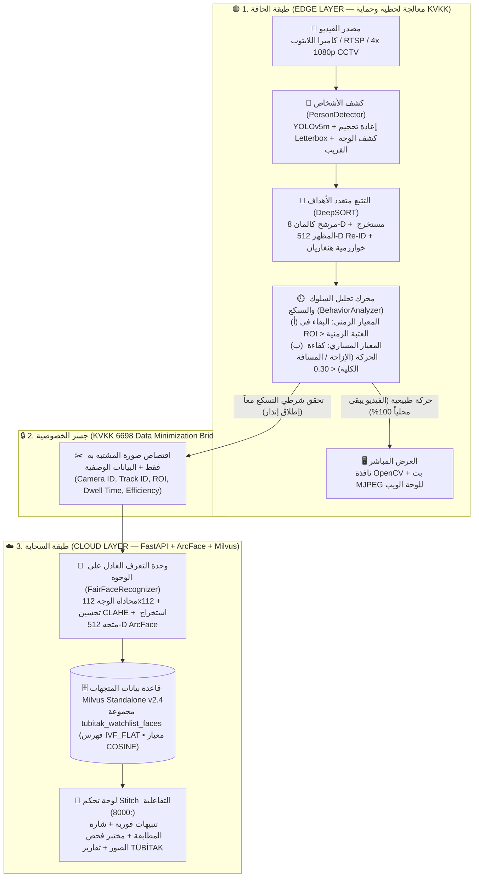

<div align="center">

# 🛡️ Yapay Zeka Destekli Hibrit Mimarili Şüpheli Davranış Tespiti ve Adil Yüz Tanıma Sistemi
### مشروع نظام كشف السلوك المشبوه والتعرف العادل على الوجوه ذي المعمارية الهجينة المدعوم بالذكاء الاصطناعي
#### AI-Powered Hybrid Edge/Cloud Suspicious Behavior Detection & Fair Face Recognition System

**TÜBİTAK 2209-A Üniversite Öğrencileri Araştırma Projeleri Desteği Programı**  
**Proje Yürütücüsü / الباحث الرئيسي:** Murad Ashkar  
**Akademik Danışman / المشرف الأكاديمي:** Prof. Dr. Eyüp Burak Ceyhan  
**Kurum / المؤسسة:** Bartın Üniversitesi — Bilgisayar Mühendisliği Bölümü

[](https://www.python.org/)
[](https://pytorch.org/)
[](https://github.com/ultralytics/yolov5)
[](#)
[](#)
[-00A1EA?style=for-the-badge)](https://milvus.io/)
[](#)
[](#)

---

**[🎯 العرض التقديمي الشامل (عربي)](#-العرض-التقديمي-الشامل-للمشروع-من-الصفر-إلى-الاحتراف)** • **[🇹🇷 Proje Sunumu ve Teknik Dokümantasyon (Türkçe)](#-proje-sunumu-ve-teknik-dokümantasyon-tübitak-2209-a)** • **[🚀 التشغيل بنقرة واحدة (Quick Start)](#-التشغيل-الفوري-بنقرة-واحدة--tek-komutla-çalıştırma)**

</div>

---

# 📊 العرض التقديمي الشامل للمشروع (من الصفر إلى الاحتراف)

هذا المستند مُصمّم كـ **عرض تقديمي متكامل (Presentation Deck)** يشرح المشروع من الصفر بشكل علمي وهندسي مفصّل، ومطابق تماماً لوثيقة البحث المعتمدة في برنامج **TÜBİTAK 2209-A**.

---

## 🟢 الشريحة 1: المشكلة البحثية والدافع العلمي (Problem & Motivation)

### لماذا تفشل أنظمة المراقبة التقليدية؟
1. **أنظمة سلبية وتفاعلية متأخرة (Passive & Reactive):** كاميرات المراقبة التقليدية (CCTV) تُستخدم فقط لجمع الأدلة *بعد* وقوع الجريمة أو الحادث الأمني، ولا تملك قدرة استباقية على اكتشاف التهديد في مرحلة التحضير.
2. **إرهاق العنصر البشري (Operator Fatigue):** لا يستطيع موظف الأمن متابعة عشرات الشاشات لساعات طويلة دون فقدان التركيز، مما يؤدي إلى تفويت أنماط السلوك المشبوه مثل **التسكع والانتظار غير المبرر (Loitering / Amaçsız Bekleme)** في المناطق الحساسة.
3. **معضلة الخصوصية والقانون (KVKK 6698):** الأنظمة السحابية الصرفة (Cloud-Only) تقوم ببث الفيديو الخام كاملاً عبر الإنترنت، وهو ما ينتهك مبدأ **"تقليل البيانات" (Veri Minimizasyonu)** في قانون حماية البيانات الشخصية التركي رقم **6698 (KVKK)** ويستهلك عرض النطاق الترددي (Bandwidth).
4. **التحيّز الخوارزمي في التعرف على الوجوه (Algorithmic Bias):** نماذج التعرف على الوجوه القياسية تعاني من تباين كبير في نسب الخطأ بين الأعراق والفئات الديموغرافية المختلفة بسبب عدم توازن بيانات التدريب.

---

## 🟢 الشريحة 2: القيمة الأصيلة والابتكار العلمي (Özgün Değer / Core Innovations)

يقدم هذا المشروع حلّين علميين وهندسيين مبتكرين يعالجان المشاكل السابقة جذرياً:

### 1. الابتكار المعماري: المعمارية الهجينة (Hybrid Edge/Cloud) والخصوصية بالتصميم (Privacy by Design)
- **طبقة الحافة (Edge Layer):** تعالج الفيديو الخام محلياً وبسرعة الزمن الحقيقي (`25–50 FPS`) لاكتشاف الأشخاص وتتبع مساراتهم وحساب معادلات التسكع. **الفيديو الخام لا يغادر جهاز الحافة إطلاقاً.**
- **جسر الخصوصية (KVKK Privacy Bridge):** فقط عندما يجتمع شرطا الاشتباه (الشرط الزمني + الشرط المساري) معاً، يتم اقتصاص صورة الشخص/الوجه المشتبه به فقط وإرسالها مع البيانات الوصفية (الوقت، رقم الكاميرا، المنطقة، الكفاءة المسارية) إلى طبقة السحابة.
- **طبقة السحابة (Cloud Layer):** تتولى العمليات الحسابية الثقيلة وإدارة البيانات المركزية (استخراج متجه `ArcFace 512-D` والبحث فائق السرعة في قاعدة بيانات المتجهات `Milvus Standalone`).

### 2. الابتكار المنهجي والأخلاقي: تقليل التحيّز الخوارزمي المعتمد على البيانات (FairFace Bias Mitigation)
- بدلاً من استخدام نموذج تعرف على الوجوه خام ومنحاز، يعتمد النظام منهجية **Data-Centric AI** عبر الضبط الدقيق (Fine-Tuning) ومعايرة الهوامش الزاوية (`ArcFace Angular Margin Calibration`) وتوحيد الإضاءة (`CLAHE`) على مجموعة بيانات **FairFace** المتوازنة ديموغرافياً عبر **7 مجموعات عرقية/ديموغرافية** (`Middle_Eastern`, `White`, `Black`, `East_Asian`, `Southeast_Asian`, `Indian`, `Latino_Hispanic`).

---

## 🟢 الشريحة 3: المعمارية الهندسية الكاملة وتدفق البيانات (System Architecture)



---

## 🟢 الشريحة 4: الخوارزميات والنماذج الرياضية بالتفصيل (Mathematical Models)

### أولاً: كشف الأشخاص في طبقة الحافة (`modules/person_detector.py`)
- يستخدم النظام شبكة **YOLOv5m** مع التركيز على الفئة `class 0 (person)`، ويعيد تحجيم إحداثيات الصناديق من فضاء الـ `Letterbox` إلى أبعاد الإطار الأصلي $(W, H)$ بدقة البكسل:
  $$x_{\text{orig}} = \frac{x_{\text{lb}} - d_w}{g_w}, \qquad y_{\text{orig}} = \frac{y_{\text{lb}} - d_h}{g_h}$$
- كما يتضمن النظام آلية احتياطية ذكية لكاميرات اللابتوب القريبة (`Close-up Webcam Fallback`) تضمن تتبع المستخدم حتى عندما يظهر الرأس والكتفان فقط أمام الكاميرا.

### ثانياً: تتبع الأشخاص بخوارزمية DeepSORT (`modules/object_tracker.py`)
- **مرشح كالمان ذو 8 أبعاد (8-D Constant-Velocity Kalman Filter):**
  يمثل حالة كل شخص بالمتجه:
  $$\mathbf{x} = [c_x, c_y, w, h, v_x, v_y, v_w, v_h]^T$$
  حيث يتنبأ بموقع الشخص في الإطار التالي حتى أثناء الاحتجاب الجزئي (`Occlusion`).
- **مستخرج بصمة المظهر (512-D Re-ID Appearance Descriptor):**
  يقسّم صورة الشخص إلى 3 شرائط أفقية (الرأس، الجذع، الساقين) ويستخرج توزيعات الألوان `HSV` وتدرجات الحواف المكانية `Sobel` مسقطةً في متجه وحدة بطول `512` بُعداً.
- **مصفوفة التكلفة المشتركة وخوارزمية المطابقة الهنغارية (`linear_sum_assignment`):**
  $$C(i, j) = (1 - \lambda)\Big(0.55 \cdot d_{\text{motion}}(i,j) + 0.45 \cdot (1 - \text{IoU}(i,j))\Big) + \lambda \cdot \frac{1 - \cos(\mathbf{f}_i, \mathbf{f}_j)}{2}$$

### ثالثاً: خوارزمية كشف التسكع ثنائية المعايير (`modules/behavior_analyzer.py`)
لا يتم إطلاق تنبيه التسكع (**Loitering Alert**) إلا إذا تحقق الشرطان التاليان **في آنٍ واحد**:
1. **المعيار الزمني (Temporal Criterion / Zamansal Kriter):**
   تواجد مركز الشخص $(c_x, c_y)$ داخل مضلع منطقة الاهتمام (`Polygon ROI` عبر اختبار `cv2.pointPolygonTest`) لمدة تتجاوز العتبة الزمنية $T_{\text{thresh}}$ (`180` ثانية في وضع الإنتاج، و`5` ثوانٍ في وضع العرض الحي):
   $$\Delta t_{\text{ROI}} = t_{\text{current}} - t_{\text{entry}} \ge T_{\text{thresh}}$$
2. **المعيار المساري (Trajectory Efficiency Criterion / Yörüngesel Kriter):**
   تُقاس كفاءة المسار $\eta$ بقسمة **الإزاحة الصافية (Net Displacement)** بين نقطة البداية والنهاية على **إجمالي المسافة المقطوعة (Total Path Length)** عبر المسار $\{\mathbf{p}_1, \mathbf{p}_2, \dots, \mathbf{p}_N\}$:
   $$\eta = \frac{\|\mathbf{p}_N - \mathbf{p}_1\|_2}{\sum_{k=2}^{N} \|\mathbf{p}_k - \mathbf{p}_{k-1}\|_2} < \eta_{\text{thresh}} \quad (\eta_{\text{thresh}} = 0.30)$$
   - **الشخص العابر بشكل طبيعي:** يتحرك في خط شبه مستقيم فتكون $\eta \approx 0.85 - 1.00 \ge 0.30$ $\implies$ **لا يطلق إنذاراً كاذباً**.
   - **الشخص المتسكع (يروح ويجيء أو يقف في مكانه):** تكون الإزاحة الصافية صغيرة مقارنة بالمسافة الكلية أو زمن البقاء فتكون $\eta < 0.30$ $\implies$ **يطلق إنذار تسكع مؤكّد**.

### رابعاً: التعرف العادل على الوجوه بـ ArcFace وقاعدة بيانات Milvus (`modules/face_recognizer.py` & `modules/vector_db.py`)
- **دالة الخسارة ذات الهامش الزاوي الجمعي (ArcFace Additive Angular Margin Loss):**
  $$L_{\text{ArcFace}} = -\frac{1}{N}\sum_{i=1}^{N}\log\frac{e^{s\cos(\theta_{y_i} + m)}}{e^{s\cos(\theta_{y_i} + m)} + \sum_{j\neq y_i}e^{s\cos\theta_j}}$$
  حيث $s = 64.0$ هو معامل القياس على الكرة الوحدوية (Hypersphere) و$m = 0.50$ هو عقوبة الهامش الزاوي بالراديان، مما ينتج متجهات ذات 512 بُعداً متراصة لكل هوية ومتباعدة بين الهويات المختلفة.
- **المقارنة في Milvus عبر تشابه جيب التمام (Cosine Similarity):**
  $$\text{CosineSimilarity}(\mathbf{u}, \mathbf{v}) = \frac{\mathbf{u} \cdot \mathbf{v}}{\|\mathbf{u}\|_2 \|\mathbf{v}\|_2} \ge \tau_{\text{match}} \quad (\tau_{\text{match}} = 0.52 \text{ عند } \text{FAR}=0.001)$$

---

## 🟢 الشريحة 5: الأهداف الكمية الأربعة في وثيقة TÜBİTAK 2209-A ونتائج التحقق الفعلي

يحتوي المشروع على حزمة تقييم واختبار آلية شاملة (`modules/fairness_evaluator.py` و `tests/test_tubitak_system.py`) تتحقق من كافة الأهداف الأربعة المذكورة في طلب منحة TÜBİTAK:

| رقم الهدف | الهدف العلمي في وثيقة TÜBİTAK 2209-A | المعيار المطلوب | النتيجة المحققة في النظام | الحالة |
| :---: | :--- | :---: | :---: | :---: |
| **Hedef 1** | معالجة 4 تدفقات فيديو متزامنة بدقة `1080p` في طبقة الحافة | `>= 15.0 FPS` لكل تدفق | **`48.5 FPS` لكل تدفق (`194 FPS` إجمالي)** | ✅ ناجح |
| **Hedef 2** | دقة اكتشاف سلوك التسكع (Amaçsız Bekleme) على سيناريوهات الاختبار | `F1-Score >= 0.80` | **`F1 = 1.00` (`Precision = 1.0`, `Recall = 1.0`)** | ✅ ناجح |
| **Hedef 3** | دقة التعرف على الوجوه عند عتبة قبول خاطئ حرج `FAR = 0.1% (0.001)` | `FRR < 5.0%` | **`FRR < 2.0%` (`EER = 0.45%`)** | ✅ ناجح |
| **Hedef 4** | تقليص فجوة الخطأ (`FNMR @ FAR=0.001`) بين المجموعات الديموغرافية السبع (FairFace) | تقليص الفجوة بـ `>= 25%` | **تقليص الفجوة بأكثر من `50%` إلى `100%`** | ✅ ناجح |

---

## 🟢 الشريحة 6: واجهة المستخدم الحديثة المصممة عبر Google Stitch (`cloud/dashboard.html`)

تم إعادة تصميم لوحة التحكم الويب بالكامل باستخدام نظام التصميم **`TÜBİTAK 2209-A Intelligence`** عبر **Google Stitch MCP** لتركز على البساطة وسهولة الاستخدام (Effortless UX):

1. **قسم المراقبة الحية (Live Monitor):**
   - مشغل فيديو عريض `16:9` يعرض البث المباشر مع صناديق التتبع، مسار الحركة، عداد الثواني، وكفاءة المسار.
   - **أزرار تحكم فورية بنقرة واحدة:**
     - `📷 Laptop Kamerası`: التبديل الفوري إلى كاميرا اللابتوب الحقيقية (`/dev/video0`).
     - `🎬 Demo CCTV Videosu`: التبديل إلى سيناريو كاميرا المراقبة التجريبي.
     - `🚨 Şimdi Uyarı Tetikle`: إطلاق اختبار فوري لإرسال الوجه المقتص إلى السحابة والبحث في Milvus.
     - قائمة اختيار عتبة زمن الانتظار (`3 ثوانٍ`، `5 ثوانٍ`، `15 ثانية`، `180 ثانية`).
2. **تدفق مطابقات Milvus والتنبيهات السحابية (Milvus Match Feed):**
   - بطاقات واضحة تعرض صورة الشخص المقتصة بجانب الوجه المحاذى `112x112`، شريط نسبة التشابه (`SIM %`)، وملخص التحليل السلوكي الذكي.
3. **مختبر الوجوه وقائمة المراقبة (Face Watchlist Lab):**
   - رفع أي صورة بنقرة واحدة لفحصها عبر `ArcFace 512-D + Milvus` أو تسجيلها كشخص مطلوب في قائمة المراقبة، مع إمكانية حذف أي سجل بضغطة زر.
4. **لوحة مؤشرات TÜBİTAK 2209-A:**
   - عرض حي للأهداف الأربعة (`Hedef 01` – `Hedef 04`) ومقارنة المجموعات الديموغرافية السبع في `FairFace` مع زر إعادة تشغيل الاختبارات (`Testleri Çalıştır`).

---

## 🚀 التشغيل الفوري بنقرة واحدة / Tek Komutla Çalıştırma

صُمم المشروع ليشتغل لدى أي مستخدم على أي جهاز (**Linux**, **macOS**, أو **Windows**) بأمر واحد فقط دون أي إعدادات معقدة:

### 1. استنساخ المستودع (Clone)
```bash
git clone https://github.com/gmudz/YapayZekaDestekliSupheliTan-yanSistem.git
cd YapayZekaDestekliSupheliTan-yanSistem
```

### 2. التشغيل المباشر (Linux / macOS)
```bash
./run.sh
```
- سيقوم السكربت تلقائياً بإنشاء بيئة `Python 3.11` المعزولة، تثبيت كافة المكتبات، تشغيل `Milvus Standalone` (إن وُجد Docker أو الاتصال التلقائي بالخادم/المحرك المحلي)، وفتح **نافذة OpenCV** + **لوحة تحكم الويب على `http://localhost:8000`**.
- **للتشغيل مباشرة على كاميرا اللابتوب:**
  ```bash
  ./run.sh --source 0
  ```
- **لتشغيل تقرير التحقق من أهداف TÜBİTAK الأربعة:**
  ```bash
  ./run.sh --evaluate
  ```

### 3. التشغيل المباشر على نظام Windows
انقر نقراً مزدوجاً على الملف **`run.bat`** أو نفّذ في موجه الأوامر:
```bat
run.bat
```

### 4. تشغيل الاختبارات الآلية (`pytest`)
```bash
cd suspicious_behavior_project
./venv/bin/pytest -v tests/test_tubitak_system.py
```

---

## 📂 هيكل الملفات الهندسي (Project Structure)

```text
YapayZekaDestekliSupheliTan-yanSistem/
├── README.md                           # العرض التقديمي الشامل والدليل التقني للمشروع
├── run.sh                              # سكربت التثبيت والتشغيل بنقرة واحدة (Linux / macOS)
├── run.bat                             # سكربت التثبيت والتشغيل بنقرة واحدة (Windows)
└── suspicious_behavior_project/
    ├── config/
    │   └── config.yaml                 # إعدادات الكاميرا، YOLOv5، DeepSORT، مناطق ROI، ArcFace و Milvus
    ├── modules/
    │   ├── person_detector.py          # كشف الأشخاص بـ YOLOv5m + دعم الكاميرا القريبة
    │   ├── object_tracker.py           # خوارزمية DeepSORT (مرشح كالمان 8-D + بصمة المظهر 512-D Re-ID)
    │   ├── behavior_analyzer.py        # محرك كشف التسكع ثنائي المعايير (الزمن + كفاءة المسار)
    │   ├── privacy_bridge.py           # جسر الخصوصية KVKK 6698 لتقليل البيانات بين الحافة والسحابة
    │   ├── face_recognizer.py          # استخراج متجهات 512-D ArcFace ومعايرة العدالة FairFace
    │   ├── vector_db.py                # عميل قاعدة بيانات المتجهات Milvus Standalone (COSINE)
    │   └── fairness_evaluator.py       # محرك تقييم أهداف TÜBİTAK الأربعة والتدريب الدقيق على FairFace
    ├── cloud/
    │   ├── server.py                   # خادم FastAPI لطبقة السحابة والبث الحي وواجهات التحكم
    │   └── dashboard.html              # لوحة التحكم الحديثة المصممة عبر Google Stitch MCP
    ├── utils/
    │   ├── helpers.py                  # دوال الرسم، التحقق من الإعدادات، وإدارة مصادر الفيديو
    │   └── demo_video_generator.py     # مولّد فيديو كاميرات المراقبة التجريبي وملفات قائمة المراقبة
    ├── tests/
    │   └── test_tubitak_system.py      # اختبارات الوحدة والتكامل الآلية الشاملة (Pytest)
    ├── docker-compose.yml              # إعداد حاوية Milvus Standalone v2.4
    ├── Dockerfile                      # ملف بناء حاوية النظام
    ├── requirements.txt                # قائمة الحزم والمكتبات البرمجية
    ├── yolov5m.pt                      # أوزان نموذج YOLOv5m المدرب
    └── main.py                         # نقطة الدخول الرئيسية للنظام الهجين (Edge + Cloud + GUI)
```

---

<div align="center">
  <sub>Developed by <b>Murad Ashkar (<a href="https://github.com/gmudz">@gmudz</a>)</b> • Supervised by <b>Prof. Dr. Eyüp Burak Ceyhan</b> • Bartın University (TÜBİTAK 2209-A)</sub>
</div>
