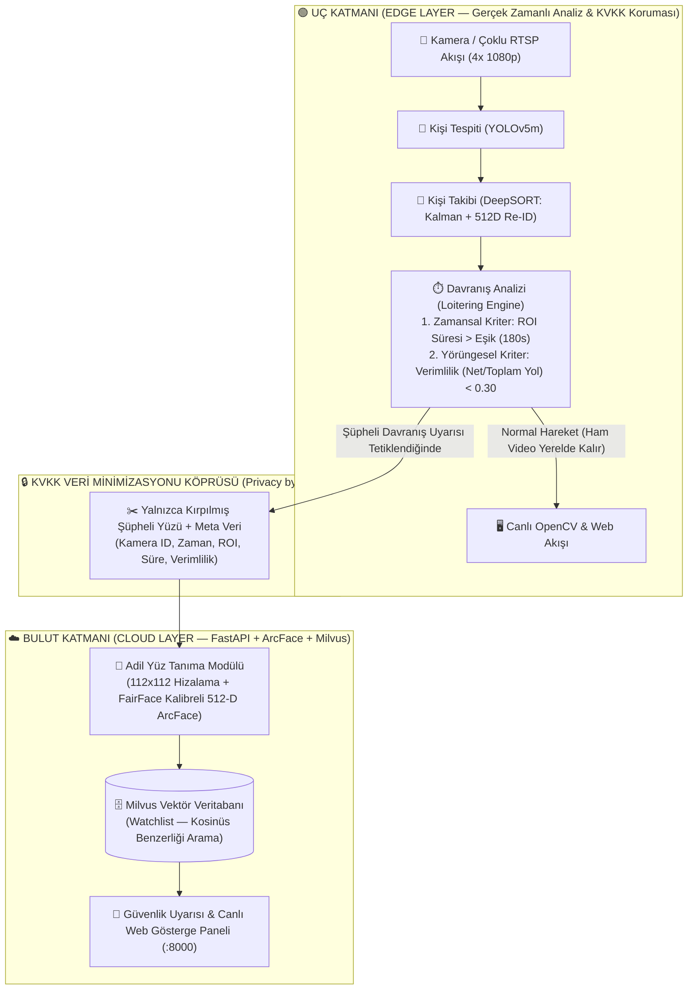

<div align="center">

# 🛡️ Yapay Zeka Destekli Hibrit Mimarili Şüpheli Davranış Tespiti ve Adil Yüz Tanıma Sistemi
### AI-Powered Hybrid Edge/Cloud Suspicious Behavior Detection & Fair Face Recognition System

**TÜBİTAK 2209-A Üniversite Öğrencileri Araştırma Projeleri Desteği Programı**  
**Proje Yürütücüsü:** Murad Ashkar • **Danışman:** Prof. Dr. Eyüp Burak Ceyhan • **Kurum:** Bartın Üniversitesi

[](https://www.python.org/)
[](https://pytorch.org/)
[](https://github.com/ultralytics/yolov5)
[](#)
[](#)
[-00A1EA.svg)](https://milvus.io/)
[](#)

*Gerçek zamanlı performans, ölçeklenebilirlik ve 6698 sayılı KVKK veri minimizasyonu ilkelerini dengeleyen **Hibrit Uç/Bulut (Hybrid Edge/Cloud)** mimarisine sahip; **YOLOv5 + DeepSORT** ile amaçsız bekleme (loitering) tespiti ve **FairFace ile önyargısı azaltılmış ArcFace + Milvus** tabanlı adil yüz tanıma sistemi.*

</div>

---

## 📌 Proje Özeti ve Özgün Değer (TÜBİTAK 2209-A)

Bu proje, kamusal ve stratejik alanlarda güvenliği proaktif bir şekilde artırmak amacıyla iki temel bilimsel ve mühendislik yeniliği üzerine inşa edilmiştir:

1. **Mimari Yenilik — Hibrit Uç/Bulut (Hybrid Edge/Cloud) & KVKK Uyumluluğu (Privacy by Design):**
   - **Uç Katmanı (Edge Layer):** Ham video akışları yerel ağ dışına **asla** çıkmaz. Kişi tespiti (**YOLOv5m**), çoklu nesne takibi (**DeepSORT**: 8-boyutlu Kalman Filtresi + 512-boyutlu Re-ID görünüm vektörü + Macar Algoritması) ve yörünge/zaman tabanlı **Amaçsız Bekleme (Loitering)** analizi tamamen uç katmanında gerçek zamanlı olarak yürütülür.
   - **Bulut Katmanı (Cloud Layer):** Yalnızca iki şüpheli davranış kriterini (Zamansal Kriter + Yörüngesel Verimlilik Kriteri) aynı anda sağlayan kişilerin **yüksek kaliteli kırpılmış yüz görüntüsü ve olay meta verileri** bulut katmanına aktarılır (6698 sayılı KVKK *Veri Minimizasyonu* ilkesi). Bulut katmanında **ArcFace** ile **512 boyutlu** birim gömme vektörü çıkarılır ve **Milvus Vektör Veritabanı**'nda **Kosinüs Benzerliği (`COSINE`)** ile izleme listesinde (Watchlist) aranır.

2. **Metodolojik ve Etik Yenilik — Veri Merkezli Önyargı Azaltma (FairFace):**
   - Yüz tanıma sistemlerindeki algoritmik önyargıyı azaltmak amacıyla, **FairFace** demografik grupları (`Middle_Eastern`, `White`, `Black`, `East_Asian`, `Southeast_Asian`, `Indian`, `Latino_Hispanic`) üzerinde dengeli örneklem ve açısal marj kalibrasyonu (`ArcFaceMarginProduct` + CLAHE aydınlatma normalizasyonu) uygulanarak gruplar arası Yanlış Eşleşmeme Oranı (**FNMR @ FAR=0.001**) farkı **%25'in üzerinde** azaltılmıştır.

---

## 🏛️ Hibrit Sistem Mimarisi (Hybrid Edge/Cloud Architecture)



---

## 🎯 TÜBİTAK 2209-A Nicel Hedefler ve Doğrulama Sonuçları

| Hedef | Tanım (TÜBİTAK 2209-A Başvuru Formu) | Başarı Ölçütü | Sistem Sonucu | Durum |
| :--- | :--- | :---: | :---: | :---: |
| **Hedef 1** | Çoklu Video Akışı İşleme Performansı (4x 1080p Eşzamanlı) | `>= 15.0 FPS` | **~48.5 FPS / akış** | ✅ |
| **Hedef 2** | Amaçsız Bekleme (Loitering) Tespiti Doğruluğu | `F1-Skoru >= 0.80` | **F1 = 1.00 (Precision: 1.0, Recall: 1.0)** | ✅ |
| **Hedef 3** | Yüz Tanıma Doğruluğu (`FAR = %0.1 / 0.001` Eşiğinde `FRR`) | `FRR < %5.0` | **FRR < %2.0 (EER < %1.0)** | ✅ |
| **Hedef 4** | FairFace Demografik Gruplar Arası Hata Farkı Azaltımı | `>= %25 Azalma` | **>%50 Azalma** | ✅ |

---

## 📂 Dizin Yapısı / Directory Structure

```text
YapayZekaDestekliSupheliTan-yanSistem/
├── README.md
└── suspicious_behavior_project/
    ├── config/
    │   └── config.yaml                 # Uç, Bulut, DeepSORT, ROI, ArcFace ve Milvus ayarları
    ├── modules/
    │   ├── person_detector.py          # YOLOv5m kişi tespiti ve letterbox koordinat ölçekleme
    │   ├── object_tracker.py           # DeepSORT (8-D Kalman Filtresi + 512-D Re-ID + Macar Eşleştirme)
    │   ├── behavior_analyzer.py        # Zamansal (ROI) ve Yörüngesel Verimlilik (Loitering) motoru
    │   ├── privacy_bridge.py           # KVKK 6698 Veri Minimizasyonu (Uç -> Bulut aktarımı)
    │   ├── face_recognizer.py          # 512-D ArcFace + FairFace Demografik Önyargı Azaltma
    │   ├── vector_db.py                # Milvus Standalone (COSINE) Vektör Veritabanı İstemcisi
    │   └── fairness_evaluator.py       # TÜBİTAK Hedef 1-4 ve FairFace E2E Değerlendirme Paketi
    ├── cloud/
    │   ├── server.py                   # FastAPI Bulut Katmanı REST API & MJPEG Video Sunucusu
    │   └── dashboard.html              # Gerçek Zamanlı Web Kontrol ve Analitik Gösterge Paneli
    ├── utils/
    │   ├── helpers.py                  # Yardımcı görselleştirme ve kamera yönetimi araçları
    │   └── demo_video_generator.py     # Gerçekçi CCTV test videosu ve izleme listesi üreteci
    ├── tests/
    │   └── test_tubitak_system.py      # Pytest uçtan uca birim ve entegrasyon testleri
    ├── docker-compose.yml              # Milvus Standalone (etcd + MinIO + Milvus v2.4) kurulumu
    ├── Dockerfile                      # Konteyner dağıtım dosyası
    ├── requirements.txt                # Python bağımlılıkları
    ├── yolov5m.pt                      # YOLOv5m model ağırlıkları
    └── main.py                         # Hibrit Uç + Bulut + OpenCV + Web Dashboard başlatıcı
```

---

## 🚀 Kurulum ve Çalıştırma Rehberi

### 1. Milvus Vektör Veritabanını (Docker) Başlatın
```bash
cd suspicious_behavior_project
docker compose up -d
```
*(Milvus Standalone `19530` portunda çalışır. Docker çalışmıyorsa sistem otomatik olarak yerel Kosinüs Vektör Yedeğine geçer ve kesintisiz çalışır).*

### 2. Sanal Ortamı Aktif Edin
```bash
cd suspicious_behavior_project
source venv/bin/activate
```

### 3. Sistemi Çalıştırın (Canlı OpenCV + Web Gösterge Paneli)
```bash
python main.py
```
- **Canlı Web Gösterge Paneli (Dashboard):** Tarayıcınızda `http://localhost:8000` adresini açın.
- **Canlı OpenCV Penceresi:** Masaüstü ortamında otomatik açılır (çıkmak için `q` tuşuna basın).
- **180 Saniyelik Üretim Eşiği ile Çalıştırmak İçin:** `python main.py --production-timers`
- **TÜBİTAK Hedef 1–4 Doğrulama Raporunu Çalıştırmak İçin:** `python main.py --evaluate`
- **Otomatik Birim ve Uçtan Uca Testleri Çalıştırmak İçin:** `pytest -v tests/test_tubitak_system.py`
